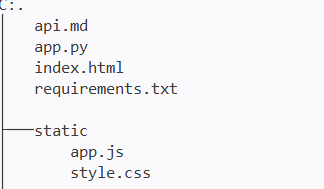

## 1.Descripción de la aplicación: Qué hace el servicio y qué problema resuelve.**

En esta api puedes consultar que películas y series hay y los datos de cada una además de poder ordenarlas alfabéticamente, por año o por puntuación. Si interesa una película o serie en específico hay un buscador que te permite obtener todos los datos d euna película/serie con solo buscar el título.

## 2.URL pública: Enlace para acceder a la página web desplegada.**

Enlace de la API -> [CineAPI](https://cineapi-6mvq.onrender.com/)

## 3.Plataforma de despliegue: Indicar en qué plataforma se ha desplegado la aplicación.**

He usado _**Render**_ para desplegar la API

## 4.Descripción detallada del proceso de despliegue**

## Requisitos

-Requirements con las dependencias necesarias (fastapi y uvicorn)

-Estructura del proyecto:



## Backend : app.py

```
from fastapi import FastAPI
from fastapi.middleware.cors import CORSMiddleware
from fastapi.staticfiles import StaticFiles
from fastapi.responses import FileResponse
from typing import Literal
from pydantic import BaseModel, Field

# ==========================================
# 1. Esquemas de datos con Pydantic
# ==========================================

# Esquema de entrada (Validación estricta)
class Buscador( BaseModel):
    titulo: str = Field(min_length=2, max_length=50, description="titulo de la película/serie")
    # anio: int = Field(ge=1980, le=2026, description="Año de la película/serie")
    # score: float = Field(gt=0, description="Valoración de la película/serie")
    # genero: str = Field(min_length=5, max_length=50, description="Género de la película/serie")
    # tipo: str = Field(description='Película o serie')
    # vista: bool = Field(default=False, description='¿Has visto la película/serie?')
    

# Esquema de respuesta tipado
class ResultadoBusqueda(BaseModel):
    titulo: str = Field(min_length=2, max_length=50, description="titulo de la película/serie")
    anio: int = Field(ge=1980, le=2026, description="Año de la película/serie")
    score: float = Field(gt=0, description="Valoración de la película/serie")
    genero: str = Field(min_length=5, max_length=50, description="Género de la película/serie")
    tipo: str = Field(description='Película o serie')
    vista: bool = Field(default=False, description='¿Has visto la película/serie?')

class Probabilidad(BaseModel):
    titulo: str = Field(min_length=2, max_length=50)
    genero_fav: str | None = None
    tipo_pref : Literal['Película','Serie'] | None = None

# ==========================================
# 2. Servidor FastAPI, CORS y Estáticos
# ==========================================

app = FastAPI(
    title="CineAPI",
    description="API para buscar una serie o película que el usuario quiere ver",
    version="1.0.0"
)

app.add_middleware(
CORSMiddleware,
allow_origins=["*"],
allow_credentials=True,
allow_methods=["*"],
allow_headers=["*"],
)

# Montamos la carpeta static para servir el código JavaScript y estilos
app.mount("/static", StaticFiles(directory="static"), name="static")

# ==========================================
# 3. Endpoints del servicio y Frontend
# ==========================================

catalogo=[
    ResultadoBusqueda( 
        titulo='Star Wars',
        anio=2006,
        genero='Acción',
        score=9.2,
        tipo='Película',
        vista=False
    ),
    ResultadoBusqueda( 
        titulo='Crimen en el paraíso',
        anio=2011,
        genero='Misterio/Drama',
        score=9.6,
        tipo='Serie',
        vista=False
    ),
    ResultadoBusqueda( 
        titulo='Avatar 3: Fuego y Cenizas',
        anio=2025,
        genero='Acción/Aventuras',
        score=8.4,
        tipo='Película',
        vista=False
    ),
    ResultadoBusqueda(        
        titulo='Lioness',
        anio=2023,
        genero='Acción/Drama/Suspenso/Thriller',
        score=8.4,
        tipo='Serie',
        vista=False
    ),
    ResultadoBusqueda( 
        titulo='Space Jam',
        anio=1996,
        genero='Animación/Comedia/Deportes',
        score=7.7,
        tipo='Película',
        vista=False
    ),
    ResultadoBusqueda(
        titulo='Stranger Things',
        anio=2016,
        genero='Terror/Drama/Suspense',
        score=8.6,
        tipo='Serie',
        vista=False
    )
]

# Ruta raíz: sirve la interfaz visual del simulador
@app.get("/", response_class=FileResponse)
def inicio():
    return FileResponse("index.html")

if __name__ == "__main__":
    # El host 0.0.0.0 es la clave para que sea accesible en tu red local
    uvicorn.run("app:app", host="0.0.0.0", port=8000, reload=True)

# 1. Endpoint que devuelve todo el catálogo
@app.get("/peliseries", response_model=list[ResultadoBusqueda])
def obtener_peliseries():
    
    return catalogo

# 2. Endpoint para una bucar una película/serie en el catálogo
@app.post("/buscar_peliserie", response_model=ResultadoBusqueda)
def buscar_peliserie(busqueda: Buscador):
    """
    Busca una película o serie que quieras ver.
    """
    for pelicula in catalogo:
        if pelicula.titulo.lower() == busqueda.titulo.lower():
            return {
                "titulo": pelicula.titulo,
                "anio": pelicula.anio,
                "genero": pelicula.genero,
                "tipo": pelicula.tipo,
                "score": pelicula.score
            }

# 3. Endpoint para calcular la probabilidad de que al usuario le gusta una película/serie

@app.post("/probabilidad")
def probabilidad_gustar(busqueda: Probabilidad):

    pelicula=next(
        (
            peli for peli in catalogo
            if peli.titulo.lower()==busqueda.titulo.lower()

        ), None
    )

    puntos=(pelicula.score/10)*50

    explicacion=[]

    explicacion.append(
        f"Puntuación: {pelicula.score}/10"
    )

    if busqueda.genero_fav:
        coincide_genero=(
            busqueda.genero_fav.lower() in pelicula.genero.lower()
        )

    if coincide_genero:

        puntos +=35

        explicacion.append("Es tu género favorito")
    else:
        explicacion.append("No es tu género favorito")  

    if busqueda.tipo_pref:

        coincide_tipo = (
            pelicula.tipo == busqueda.tipo_pref
        )

        if coincide_tipo:

            puntos+=15

            explicacion.append("Es tu tipo preferido")
        else:
            explicacion.append("No es tu tipo preferido") 

    maximo=50

    if busqueda.genero_fav:
        maximo+=35

    if busqueda.tipo_pref:
        maximo+=15

    porcentaje=round((puntos/maximo)*100,1)

    return{
        'titulo':busqueda.titulo,
        'probabilidad':porcentaje,
        'explicacion':explicacion
    }

# 4. Endpoint de comprobación de salud del servicio (Health Check)
@app.get("/check")
def estado_servicio():
    return {
        "estado": "OK",
        "memoria_disponible": "85%",
        "modelos_cargados": 1
    }
```

## Enlace a static

```
<script src="/static/app.js" defer></script>
```

## Paso 1: Conectar Github a Render

Primero iniciamos sesión en Render y nos saldrá una pestaña en la que te va a pedir conectar Github (puedes usar Github o cualquira de las opciones que te ofrece Render) para obtener los archivos necesarios para desplegar la API, para ello clickamos en el icono de Github y una vez dentro se te envirá por un correo para verificar la conexión, lo introducimos y Render ya puede coger esos archivos.

## Paso 2: Configurar Render

Una vez esté conectado Github deberemos de configurar ciertos aspectos* de Render para el despliegue.
Hay que seleccionar el repositorio que se va a utilizar en _**Source**_  (usuario/API por ejemplo), en el apartado _**Build Command**_ deberemos de definir el comando para construir la API antes de lanzarla que será algo así  _**pip install -r requirements.txt**_ (esto instala las dependencias necesarias), después en _**Start Comand**_ deberemos de definir el comando para arrancar la API y desplegarla, será algo así _**uvicorn app:app --host 0.0.0.0 --port $PORT**_ (susitituye app por el archivo python que tengas, si se llama apirest pues será  _**uvicorn apirest:app --host 0.0.0.0 --port $PORT**_).

_*Los aspectos mencionados son los más importantes para arrancar la API, lo demás es secundario (nombre de la api,...)_

## Paso 3: Arrancar la API

Una vez hemos configurado Render clickamos en _**'Apply Deploy'**_ y dejamos que Render lea los archivos y configure todos, si ha salido todo bien saltará un mensaje _**Build succesfull**_ y el enlace de la API que será algo así: **https://cineapi-6mvq.onrender.com/**